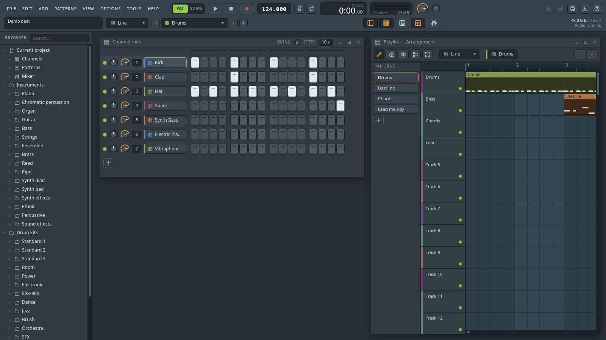
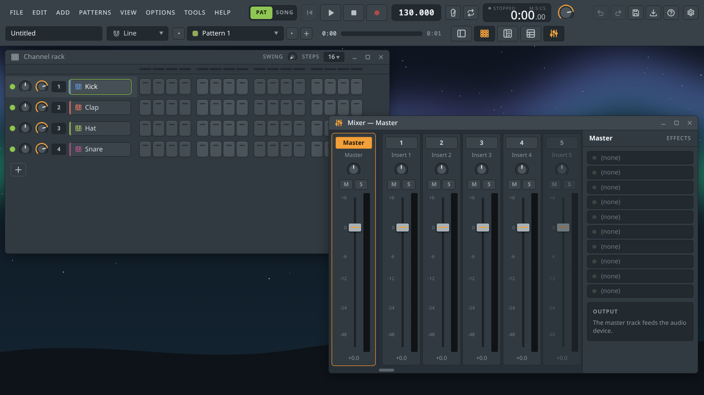
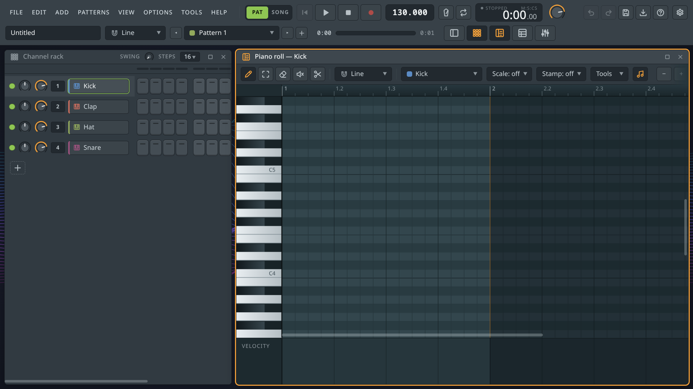
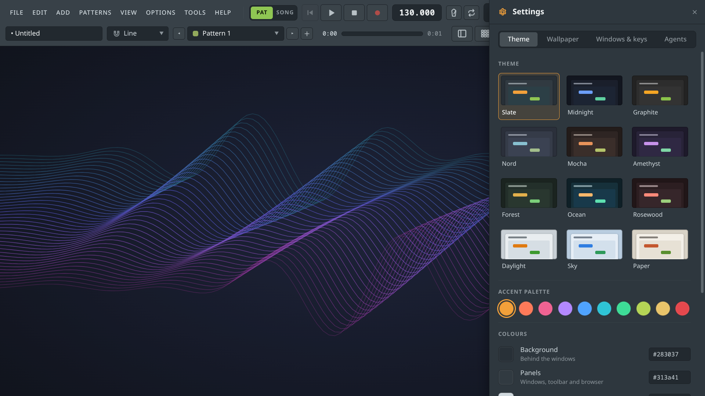
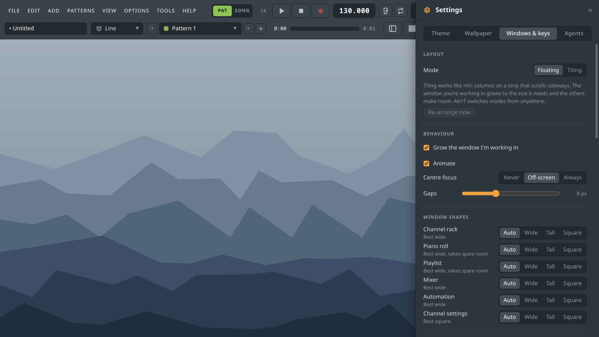
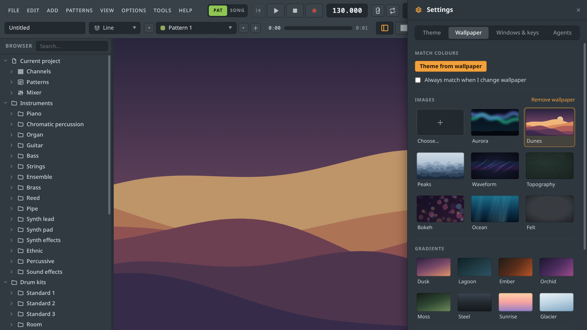

# OpenStudio

An open-source, pattern-based digital audio workstation for the desktop — a familiar step-sequencer /
piano-roll / playlist / mixer workflow built with **Electron** and the **Web Audio API**, with no build step.

[](../../actions/workflows/ci.yml)
[](LICENSE)



> **Status: early (0.x).** It makes music today, but it is not a replacement for a mature DAW yet —
> see [Limitations](#limitations) and the [roadmap](docs/ROADMAP.md). Contributions are very welcome.

## Features

**Sound**
- 261 General MIDI instruments and 13 drum kits (TR-808/909, Electronic, Jazz, Orchestral, …) from the
  [GeneralUser GS](assets/CREDITS.md) SoundFont, played by a built-in sampler engine (velocity, loops, envelopes,
  filters, vibrato, hi-hat choke).
- Built-in generators with presets: a subtractive synth (dual oscillator, 11 waveforms, unison, sub, 12/24 dB filter, LFO),
  an FM synth, a tonewheel organ, Karplus-Strong plucked strings and a Sound FX generator (risers, impacts, sweeps, textures);
  26 synthesized drum voices (808, punchy, acoustic-style); and a sampler for your own audio files.
- Mixer effects: reverb, delay, chorus, phaser, distortion, filter, EQ, compressor, limiter, stereo width.

**Workflow**
- **Channel rack** step sequencer — pads are real piano-roll notes — with swing, mute/solo and mixer routing.
- **Piano roll** with draw / select / delete / mute / slice tools, scale highlighting, ghost notes, velocity lane,
  quantize, and drum-kit key labels.
- **Playlist** with pattern, audio and automation clips, loop region, drag-and-drop of samples and audio files.
- **Mixer** with 125 inserts, sends (feedback-protected), 10 effect slots per track and stereo meters.
- **Automation** — right-click any knob or fader to create an automation clip with an editable curve.
- **AI agents** can do everything you can through a built-in [MCP server](docs/AGENTS.md) — and they work like a producer:
  pick a style, get a matching set of instruments, write a whole arrangement in key and in form, have the writing reviewed
  by a music critic, mix from measured stems, then render. You watch it happen live and can undo any of it.
- Undo/redo, `.osp` project files, WAV and MIDI export, computer-keyboard and MIDI-keyboard input, live recording.

**Desktop**
- **Theming** — 12 preset themes (including light ones), 10 accent palettes and custom colours in a Settings drawer
  (gear button, <kbd>Ctrl</kbd>+<kbd>,</kbd>); 8 preset wallpapers, gradients, solid colours or your own image (with fit,
  dim and blur), plus **Theme from wallpaper**, which builds a matching theme from an image's colours.
- **Tiling or floating layout** — niri-style tiling (**Alt+T**): windows tile in columns on a sideways-scrolling strip,
  the window you're working in grows to fit and the others make room; every binding, the gaps, centre-focus and each
  window's preferred shape are configurable in **Settings → Windows & keys**. Floating stays the default.
- **In-app updates** — **Help → Check for updates…** finds the newest GitHub release and installs it in one click, with
  SHA-256 verification; Linux AppImages ship a statically-linked runtime so they run without `libfuse2`.
- Export audio with a progress bar you can cancel; a first-launch welcome; hover menus that close themselves; and a
  transport with back-to-start, PLAYING / PAUSED / STOPPED indicators and a song-position slider.

## Screenshots

**Channel rack & mixer** — step sequencing with swing, mute/solo and mixer routing, beside a 125-insert mixer with
sends and stereo meters.



**Piano roll** — draw, select, delete, mute and slice tools, scale highlighting, ghost notes, quantize and a velocity lane.



**Theming** — pick a preset theme, accent and colours, and match the whole UI to your wallpaper in one click.



**Layout** — floating or tiling, with per-window shape presets, gaps and centre-focus behaviour you can tune.



**Browser & wallpapers** — browse instruments, drum kits and project content beside the wallpaper picker.



## Getting started

Requirements: [Node.js](https://nodejs.org) 22 or newer.

```bash
git clone <this repository>
cd openstudio
npm start
```

That's it. `npm start` automatically installs anything missing before launching (via the `prestart` hook in `scripts/ensure.mjs`), including dependency repair and the ~31 MB checksum-verified GeneralUser GS instrument bank, so you never need to run `npm run assets` by hand. On a machine with no Node.js/npm at all, run `./start.sh` instead — it installs Node.js/npm first (apt, dnf, pacman, zypper, or Homebrew) and then starts the app.

Then choose **File → Open demo project**, press <kbd>Space</kbd> to play, and <kbd>F1</kbd> for shortcuts.

If Electron's binary is broken by a skipped postinstall step or a corrupted download cache, delete the stale copy with `rm -rf node_modules/electron && npm install` — or just rely on `npm start`, which repairs it for you.

### Handy keys

| Key | Action |
| --- | --- |
| <kbd>Space</kbd> | Play / pause |
| <kbd>F5</kbd> <kbd>F6</kbd> <kbd>F7</kbd> <kbd>F9</kbd> | Playlist, Channel rack, Piano roll, Mixer |
| <kbd>Z</kbd>…<kbd>M</kbd> / <kbd>Q</kbd>…<kbd>U</kbd> | Play the selected channel from the keyboard |
| <kbd>Ctrl</kbd>+<kbd>Z</kbd> / <kbd>Y</kbd> | Undo / redo |
| <kbd>Ctrl</kbd>+<kbd>S</kbd> / <kbd>O</kbd> / <kbd>R</kbd> | Save, open, export audio |
| Right-click a knob | Create an automation clip |

## Agents (MCP)

OpenStudio serves the Model Context Protocol on `http://127.0.0.1:6736/mcp` while it runs (this computer only;
`--no-mcp` turns it off), so an AI agent can compose, arrange, mix and export in the open app while you watch.

**Quick setup:** download the OpenStudio app from the [releases page](https://github.com/Ember2819/openstudio/releases),
then copy this prompt into your coding agent (Claude Code, Codex, Cursor, …) and it will connect itself:

````text
Set up OpenStudio (an open-source DAW) so you can work on music projects in it through its built-in MCP server.

1. Find the OpenStudio app I downloaded (look in Downloads and the usual app locations: OpenStudio-*.exe,
   OpenStudio-*.AppImage, OpenStudio.app) and launch it. If you can't find it, ask me where it is. Linux AppImages
   may need `chmod +x` first. Leave it running.
2. Check that http://127.0.0.1:6736/mcp is up: POST a JSON-RPC `ping` to it. If the port is busy, the app prints
   `[mcp] listening on <url>` on start-up; use that URL instead.
3. Register it as an MCP server named "openstudio" (Streamable HTTP, no auth) in whichever way YOUR client supports.
   For Claude Code: `claude mcp add --transport http openstudio http://127.0.0.1:6736/mcp`. For OpenCode: add
   `"mcp": { "openstudio": { "type": "remote", "url": "http://127.0.0.1:6736/mcp", "enabled": true } }` to
   `~/.config/opencode/opencode.json` and restart it. For clients with a JSON
   config: `{ "mcpServers": { "openstudio": { "url": "http://127.0.0.1:6736/mcp" } } }`. If your client only
   supports stdio MCP servers, use the bridge in the OpenStudio repo instead:
   `node scripts/mcp-stdio.mjs --launch` (clone https://github.com/Ember2819/openstudio if needed).
4. Reload or restart yourself if your client needs that to pick up new MCP servers, then confirm the `openstudio`
   tools are available (e.g. call `get_project`).
5. Read https://github.com/Ember2819/openstudio/blob/main/docs/AGENTS.md for the tool list and conventions
   (time is in steps: 16 = 1 bar; MIDI 60 = C5; use `render_audio` to check the mix since you can't hear it).
6. Tell me when it works, then ask what I'd like to make. Don't overwrite my unsaved work.
````

More setup options, the tool list and the security model are in [docs/AGENTS.md](docs/AGENTS.md).

## Development

```bash
npm run lint        # ESLint
npm test            # unit tests (node:test) — store, automation, MIDI writer, SoundFont parser
npm run test:e2e    # launches the real app headlessly and smoke-tests playback, mixing, export
npm run test:e2e:mcp # drives the real app through its MCP server with the official client
```

The app is plain ES modules loaded straight by Electron — edit a file and restart. A headless screenshot /
scripting harness is built into `main.js` (see [CONTRIBUTING](CONTRIBUTING.md#debugging-and-screenshots)).
For a tour of the code read [docs/ARCHITECTURE.md](docs/ARCHITECTURE.md).

## Limitations

Plugin (VST/CLAP) hosting, time signatures other than 4/4, time-stretching audio, audio recording, tempo
automation, importing other DAWs' project files, and most of the commercial DAWs' bundled instruments and effects
are not implemented. OpenStudio is an independent project and is not affiliated with, endorsed by, or derived
from any commercial DAW; product names mentioned in this repository belong to their respective owners.

## Contributing

Bug reports, ideas and pull requests are welcome — start with [CONTRIBUTING.md](CONTRIBUTING.md) and the
[Code of Conduct](CODE_OF_CONDUCT.md). Report security issues privately as described in [SECURITY.md](SECURITY.md).

## License

Code: [MIT](LICENSE). Audio assets are covered by their own licenses — see [assets/CREDITS.md](assets/CREDITS.md).
